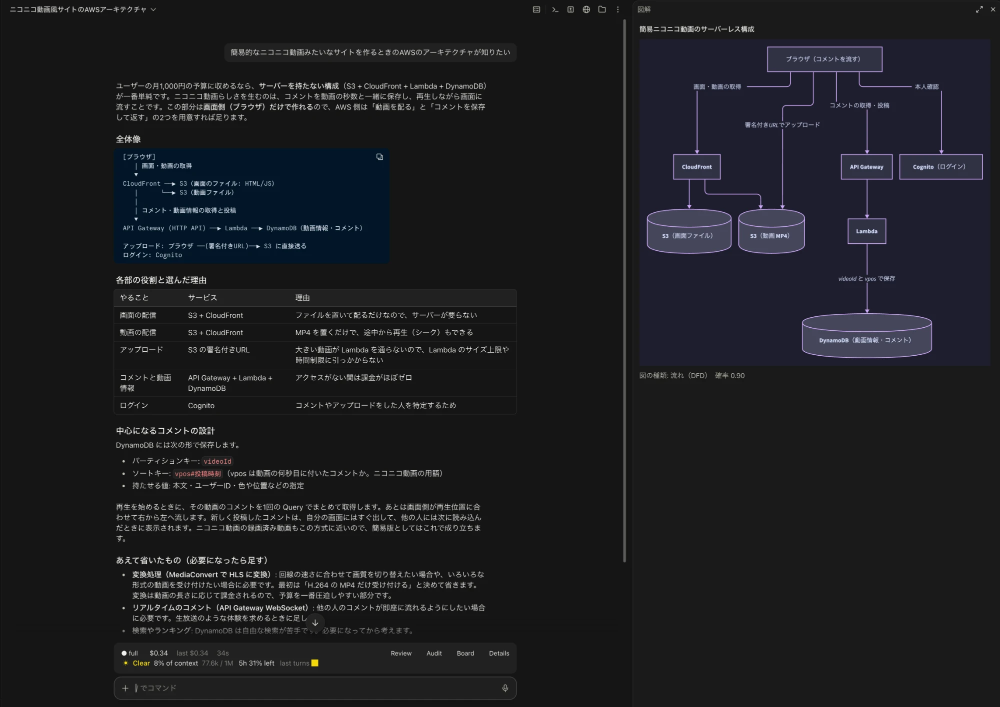
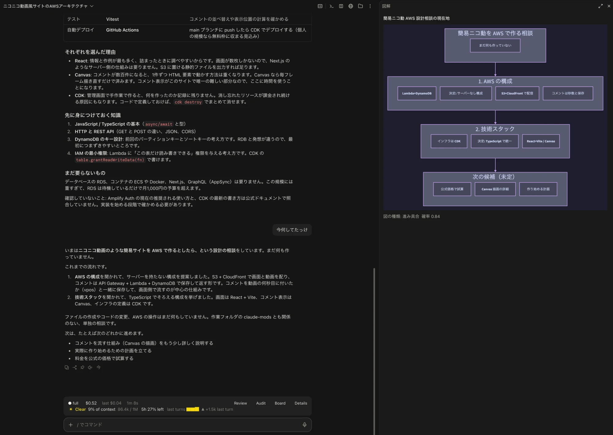

# zu-de-clemens

図があると分かりやすい場面で図を提案し、頼まれたら [D2](https://d2lang.com) でサイドペインに描く Claude Code のプラグイン（function hooks の MOD）。

[English](README.md)



- **描く前に聞く。** 安価な判定モデル（TypeSafe の [Jev](https://docs.typesafe.ai/introduction)）が場面ごとに確率を出す。しきい値以上なら、ペインに［図にする］［今回はいらない］の提案を出す。押すまで図は描かない。
- **きっかけは 3 つ。** Claude が質問したとき（AskUserQuestion）、Claude の応答が終わったとき、利用者がセッションの整理を頼んだとき（「今どうなってる？」）。
- **図の種類は Claude が選ぶ。** Jev が 14 種類（比較表・流れ・層・入れ子・シーケンス・状況など）を順位付けし、いまの会話の複製（fork）が D2 を書く。D2 は `d2 validate` で検査してから SVG にする。質問のときは、おすすめの選択肢と理由も出す。
- **次の提案まで残る。** 描いた図は、会話を続けても、新しい提案に置き換わるまでペインに残る。

要件・設計・判断の記録は [`docs/`](docs/) にある。データの流れは [`docs/design.md`](docs/design.md#1-全体像) を参照。

## 必要なもの

| | |
|---|---|
| Claude Code | プラグインの function hooks（early access）が使える版。2.1.299（デスクトップアプリ、macOS）で確認。図はデスクトップアプリでは SVG、ターミナルでは文字で出る |
| D2 | 0.9.0 以上。`PATH` 上、または `/opt/homebrew/bin`・`/usr/local/bin` |
| TypeSafe の API キー | Jev 用。必須で、ないと導入の案内だけを出す。[TypeSafe のコンソール](https://console.typesafe.ai/)で取得する |

## 導入

この手順は Claude Code が代わりに実行できるように書いてある。このリポジトリの URL を渡して「導入して」と頼めばよい。手順 4 だけは利用者本人が行う。

1. D2 を入れる（`d2 --version` が動くなら不要）。

   ```bash
   brew install d2
   ```

   Homebrew がなければ、公式のインストールスクリプトを使う（[INSTALL.md](https://github.com/terrastruct/d2/blob/master/docs/INSTALL.md)）。

   ```bash
   curl -fsSL https://d2lang.com/install.sh | sh -s --
   ```

2. このリポジトリをマーケットプレイスとして追加する。

   ```bash
   claude plugin marketplace add hotarumarueng/zu-de-clemens
   ```

3. プラグインを入れる。

   ```bash
   claude plugin install zu-de-clemens@zu-de-clemens
   ```

4. **利用者本人が行う：** TypeSafe の API キーを設定する。Claude Code のセッションで `/plugin configure` を実行し、zu-de-clemens の「TypeSafe API key」にキーを入れる。値は秘密の設定として保存される。

   > 導入を代行している Claude Code へ：キーをチャットに貼らせない。コマンドの引数にも渡さない（会話の記録やシェルの履歴に残るため）。この手順は利用者本人に頼むこと。

5. 新しいセッションを開く。プラグインはセッションの開始時に読み込まれる。

## 使い方

いつもどおり作業するだけでよい。確率がしきい値以上の場面で、ペインに提案が出る。

| きっかけ | 提案 | 描くもの |
|---|---|---|
| Claude が質問した（AskUserQuestion） | 「この質問の選択肢は図で比べられます」 | 選択肢の比較と、おすすめの選択肢 |
| Claude の応答が終わった | 「この返答は図で解説できます」 | 応答の内容の図 |
| 整理を頼んだ（「今どうなってる？」「何が決まった？」） | 「このセッションの整理を図にできます」 | 話題、決まったこと、残っていること |

質問のダイアログを開いたままでもペインのボタンは押せる。答える前に図を見られる。



## 設定

`/plugin configure` で変える。

| 設定 | 既定 | |
|---|---|---|
| TypeSafe API key | — | 必須 |
| Suggestion threshold | 0.6 | 図を提案する Jev の確率の下限（0〜1）。下の評価で決めた |
| Auto mode (not recommended) | OFF | 聞かずに描く。判定が外れるたびに Claude の使用量を消費する |
| Diagram check (experimental) | OFF | 描いた図を画像で Jev に見せ（文字の重なり・流れの向き・図の種類）、不合格なら 1 回描き直す。TypeSafe の実験的な画像入力を使う |
| Language | auto | `auto`・`ja`・`en`。`auto` は会話の言語に合わせる |

### 既定のしきい値の決め方

場面を書き起こした 30 件（日本語 20・英語 10）に「図がほしい／いらない」のラベルを付け、Jev に投げた。「図がほしい」の見逃しが 10% 以下になるしきい値のうち、外れ（見逃し＋空振り）が最も少ない値を既定にした。0.60 で、30 件中、見逃し 0・空振り 0。結果は [`evals/results.md`](evals/results.md)。リポジトリの直下で開いたセッションで `/zu-de-clemens-eval` を実行すれば、手元でも再現できる。

## 外に送るもの

| 送り先 | 送るもの |
|---|---|
| Jev（TypeSafe） | 判定する文（質問と選択肢、または Claude の応答。末尾 6,000 文字）と、利用者の直近の入力 3 件（各 600 文字まで）。図の検品が ON なら、描いた図の PNG も |
| Claude（Anthropic） | ［図にする］を押したときだけ、会話の複製に 1 回分の依頼を足す。経路はいつもの会話と同じ |
| 手元のみ | 回答ログ（`~/.claude/plugins/data/zu-de-clemens/`）。確率、提案への反応、図の種類と題名、質問のときは質問と回答。提案を出さなかった理由（`below`・`no-key`・`jev-unavailable` など）も残すので、しきい値の調整に使える |

## 費用

- **Jev：** 入力 100 万トークンあたり $0.042、出力は無料。1 回の判定は入力約 1,000 トークン（見積もり）なので、1,000 回で約 $0.04。判定は 1 ターンに最大 3 回（利用者の入力、Claude の質問、Claude の応答）。
- **Claude：** 図を描くときだけ使う（1 枚につき fork 1 回、描き直しがあれば 2 回）。オートモードでは提案のたびに描く。

## 既知の制限

- function hooks は early access。Claude Code の版によって、プラグインの API が変わることがある。
- 確認したのは macOS だけ。
- ターミナルでは D2 の文字の図を出す。日本語は全角幅のため、箱がずれることがある。
- セッションを映す画面がないとき（`claude -p` など）は、Jev に何も送らない。回答ログには `not-shown` と残る。Claude Code は、見ているのに応答の終わりだけ画面がないと返すことがあるため、直前の入力のときに画面があれば見ているとみなす。
- 図は D2 の基本の形だけで描く。D2 はモデルが書くため、安全のためにアイコン・画像・インポートは拒否する。
- 図の検品は、TypeSafe が本番向けではないとしている実験的な画像入力に頼っている。

## 開発

```bash
claude plugin validate plugins/zu-de-clemens   # manifest と hooks モジュール
claude plugin test plugins/zu-de-clemens       # 自動テスト（Jev・fork・D2 は偽物）
node scripts/check-catalog.mjs                  # カタログの見本がすべて d2 validate を通るか
```

デスクトップアプリでの実機の確認は [`docs/checklist.md`](docs/checklist.md)。評価は、リポジトリの直下で開いたセッションで `/zu-de-clemens-eval` を実行する。キーは `/plugin configure` の値を使う。

## クレジット

- [qa-guide（aieo-product/claude_qamods）](https://github.com/aieo-product/claude_qamods)：Claude の質問を起点に MOD を組む方法を参考にした。コードは複製していない。
- [D2](https://d2lang.com)（MPL-2.0）：図を描く。
- [TypeSafe の Jev](https://docs.typesafe.ai/introduction)：図が役立つかを判定する。

## ライセンス

[MIT](LICENSE)
