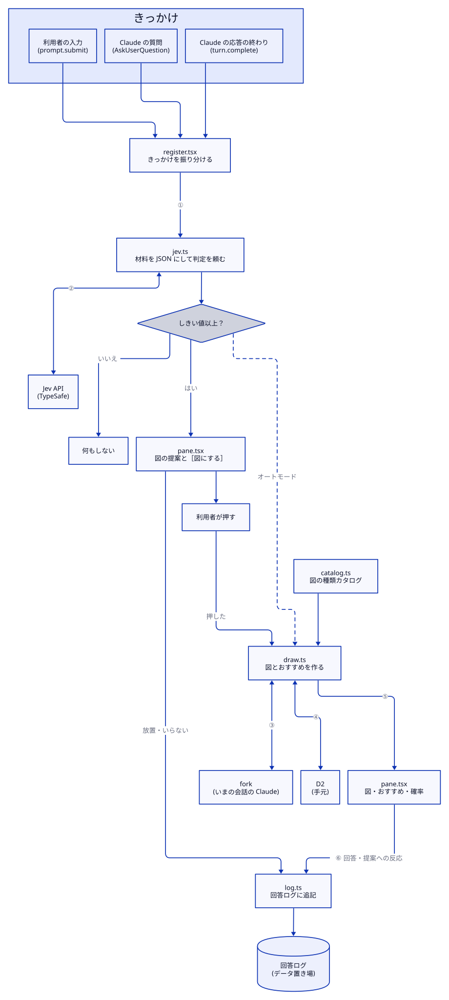

# 設計

- 状態: 承認済み（2026-10-18）
- 最終更新: 2026-10-18
- 前提: [要件](requirements.md)（2026-10-16 承認、以降の変更は要件の決定事項の表に記録）
- 用語: [CONTEXT.md](../CONTEXT.md)

## 1. 全体像



図の元は [images/dataflow.d2](images/dataflow.d2)。番号の矢印で受け渡すものは 3 章にまとめる。

MOD は Claude Code の function hooks で動く。3 つのきっかけを受けると、Jev が「図にすべきか」を安く判定する。しきい値以上なら、ペインに図の提案を出す。利用者が［図にする］を押したときだけ、いまの会話の複製（fork）に D2 を書かせ、SVG にして表示する。オートモード（非推奨）では、提案を飛ばして自動で描く。

外で動くものは 3 つ。障害の影響範囲もこの 3 つで分かれる。

| 外部 | 場所 | 止まったときの影響 |
|---|---|---|
| Jev API | TypeSafe（インターネット） | 提案が出なくなるだけ |
| fork | いまの会話の Claude | 図が作れず、失敗をペインに表示する |
| D2 | 利用者の Mac（`$.process.run`） | 同上 |

## 2. ファイル構成

### リポジトリ

```text
zu-de-clemens/
├── .claude-plugin/marketplace.json   配布の目録（名前は zu-de-clemens）
├── plugins/zu-de-clemens/            MOD 本体とテスト
├── evals/                            評価データ・実行スクリプト・結果
├── docs/requirements.md              要件
├── docs/design.md                    この文書
├── docs/adr/                         大きな判断の記録
├── docs/plans/                       実装計画
├── CONTEXT.md、README.md、README.ja.md、LICENSE
└── .github/workflows/ci.yml          検証・型チェック・自動テスト
```

### MOD 本体（`plugins/zu-de-clemens/`）

| ファイル | 責務 | 要件 |
|---|---|---|
| `hooks/register.tsx` | イベントを受け、下の部品に振り分ける。判断はしない | 全体 |
| `hooks/jev.ts` | 判定の材料（JSON）と質問を組んで Jev に送り、確率を返す。失敗は「判定なし」として返す | R1〜R3 |
| `hooks/catalog.ts` | 図の種類カタログ（14 種） | R13 |
| `hooks/draw.ts` | fork に D2 とおすすめを書かせ、検査・書き直し・SVG と文字の図への変換をする | R5 |
| `hooks/pane.tsx` | ペインの表示（提案、図、おすすめ、確率、案内、失敗） | R6、R9 |
| `hooks/log.ts` | 回答ログへの追記 | R7 |
| `types/index.d.ts` | ペインが読む `$.state` の型 | — |

qa-guide（aieo-product/claude_qamods）のコードは複製しない。フックの組み方を参考にするだけとし、README のクレジットに記す。

## 3. データの流れ

### きっかけ

| 要件 | イベント | 拾う条件 |
|---|---|---|
| R1 | `tool.call`（`AskUserQuestion`） | すべて |
| R2 | `turn.complete` | 本体の会話（`agentId` なし）、`reason` が `answer`、`answer` が空でない |
| R3 | `prompt.submit` | 利用者が入力したもの（origin が composer・bridge・sdk）、本文が空でない |

どのフックも MOD の処理を待たずに `next(e)` へ進み、MOD の処理は裏で走らせる。

### 矢印ごとの受け渡し

| 番号 | 受け渡すもの |
|---|---|
| ① | きっかけの種類と対象の文（質問文と選択肢、応答の本文、入力文のいずれか）、直近の入力 3 件 |
| ② | 往路：判定の材料（JSON）と質問。復路：確率 |
| ③ | 往路：描き方の指示。復路：D2 のコードブロックと `KIND` `TITLE` `RECOMMEND` の行 |
| ④ | 往路：D2 のテキスト。復路：検査結果、SVG と文字の図（失敗ならエラー文） |
| ⑤ | 表示に使う一式（SVG、文字の図、おすすめ、確率、図の種類、題名） |
| ⑥ | 利用者の反応（質問への回答、提案への反応：押した／いらない／放置） |

### 同時に起きたとき

きっかけごとに通し番号を振る。描いている途中で次のきっかけが来たら、新しい方を優先し、古い番号の結果は表示しない。

## 4. Jev への聞き方（`jev.ts`）

### 材料（state）

docs の推奨に従い、名前付きの項目にした JSON にする。

| 項目 | 中身 |
|---|---|
| `target.kind` | `question`（R1）、`answer`（R2）、`prompt`（R3） |
| `target.text` | 判定対象の文 |
| `recent_prompts` | 利用者の直近の入力 3 件 |

### 質問

1 回のリクエストにまとめて送る（独立した質問は並列に処理される）。質問文と判定条件は英語で書く。材料の中身は元の言語のまま渡す。

| きっかけ | 質問 ID | 型 | 判定条件 |
|---|---|---|---|
| R1・R2 | `needs_diagram` | Noul | はい：部品の関係、影響範囲、流れ、比較、入れ子があり、文章だけより図の方が分かりやすい。いいえ：単純な事実、はい／いいえで済む答え、短い定義、雑談 |
| R1・R2 | `diagram_kind` | Choice | カタログの 14 種と `none` |
| R3 | `session_summary` | Noul | 要件「セッションの整理を頼んでいるか」の定義と例の表 |

- モデル：`jev-latest`
- 送り先：`POST https://api.typesafe.ai/v1/systemone`、`$.http.fetch` で送る
- 打ち切り：10 秒
- 1 回の判定の見込み：約 300〜1,000 入力トークン、0.002〜0.006 円

## 5. 図の種類カタログ（`catalog.ts`）

種類ごとに、ID、名前（日本語・英語）、使う場面（1 行）、D2 の型の見本を持つ。

| ID | 名前 | 使う場面 |
|---|---|---|
| `decision` | 判断の分岐 | 条件によって選ぶものが変わる |
| `comparison` | 比較表 | 選択肢の違いを項目ごとに並べる |
| `matrix` | 2×2 マトリクス | 2 つの軸で選択肢を配置し、おすすめの根拠を示す |
| `layers` | 層 | 画面・処理・データのような重なり |
| `containment` | 入れ子 | 何が何の中にあるか（IAM の影響範囲、VPC など） |
| `hub` | ハブ | 1 か所に集まり、そこから配られる |
| `flow` | 流れ（DFD） | データや処理が順に渡る |
| `swimlane` | スイムレーン | 誰が、どの順で、何をするか |
| `sequence` | シーケンス | 誰が誰に、どの順で呼びかけるか |
| `tree` | ツリー | 親子関係・分類 |
| `relations` | 連携 | 3 者以上の相互のやりとり |
| `steps` | ステップ | 段階・手順 |
| `er` | ER 図 | データどうしの関係 |
| `status` | 進み具合 | R3 専用。話題ごとに、決まったこと・残っていること |

循環、ファネル、ベン図、イラスト、地図は入れない。D2 で描きにくいか、会話の説明での出番が少ないため。

## 6. 図を作る（`draw.ts`）

### fork への指示

- 頼むこと：いまの会話について、サイドペインに出す図を 1 枚描く
- 材料：きっかけの種類と対象の文、Jev の図の種類の上位 3 つとその確率、その 3 種の使う場面と D2 の見本
- 描き方の決まり：流れは一方向、箱は 12 個まで、ラベルは 20 文字まで、色や装飾は付けない、ラベルの言語は会話に合わせる
- 返す形：D2 のコードブロックと、`KIND: <ID>`、`TITLE: <題名>`、`RECOMMEND: <おすすめと理由>`（R1 のみ）。それ以外は書かない

図の種類は Jev の候補を参考に Claude が最終的に決める。カタログの中なら上位 3 つ以外も選べる。

### 検査と変換

1. 返答から D2 のコードブロックと 3 行を取り出す。取り出せなければ失敗として扱う
2. `d2 validate -` で検査する。失敗したら、エラー文（行と位置つき）を添えて fork に 1 回だけ書き直させる。2 回目も失敗したら、失敗をペインに表示する
3. SVG（デスクトップ用）：`d2 --layout=elk --theme 0 --dark-theme 200 --scale 1 --pad 20 - -`
4. 文字の図（ターミナル用）：`d2 --layout=elk --stdout-format ascii - -`
5. `$.process.run` の打ち切りは 10 秒

レイアウトは ELK を使う。TALA は `direction: down` を指定しても横に広がり、流れの向きが揃わなかった（このデータフロー図で確認、2026-10-18）。

## 7. ペイン（`pane.tsx`）

| 状態 | 表示 |
|---|---|
| 提案 | きっかけ、図の種類の候補、確率、［図にする］［今回はいらない］ |
| 作成中 | 作成中であること |
| 図 | 題名、図（デスクトップは `Svg`、ターミナルは文字の図）、おすすめ（R1）、図の種類、確率 |
| 案内 | キー・D2 がない、キーが無効、など（R9）。1 セッションに 1 回 |
| 失敗 | 何が失敗したか（fork、D2、会話が始まる前） |

`Svg` の幅は図の本来の幅とペインの幅の小さい方にし、小さな図を拡大しない。

## 8. 設定（`userConfig`）

| キー | 型 | 既定値 | 要件 |
|---|---|---|---|
| `typesafe_api_key` | 文字列、`sensitive: true`、必須 | なし | R10 |
| `threshold` | 数値 0〜1 | 評価データで決める | R11、R12 |
| `auto_mode` | 真偽 | `false` | R15 |
| `image_check` | 真偽 | `false` | R8 |
| `language` | `auto`／`ja`／`en` | `auto` | R14 |

## 9. 回答ログ（`log.ts`）

- 置き場所：`~/.claude/plugins/data/zu-de-clemens/<プロジェクト名>-<パスのハッシュ>.md`。`$.fs.write` で書く（試験で書けることを確認済み）
- 1 件の中身：日時、きっかけ、Jev の確率と図の種類、提案への反応（押した／いらない／放置）、採用された図の種類と題名、R1 なら質問と回答

## 10. エラーの扱い

大原則：MOD が失敗しても、Claude の作業と利用者の入力を止めない。例外はフックの中ですべて受け止める。

| 起きること | 扱い |
|---|---|
| キー・D2 がない | 案内を出す（1 セッションに 1 回） |
| Jev が 401 | 「キーが無効」と案内する |
| Jev が 429／529／5xx、10 秒で返らない | そのきっかけは何もしない。再試行しない。デバッグログに 1 行 |
| fork が `nothing-to-fork` | 「会話が始まってから図にできます」と表示する |
| fork・D2 が失敗、D2 が 10 秒で返らない | 失敗を表示する |
| 回答ログが書けない | デバッグログのみ |

## 11. 外に送るもの

README に明記する。

| 送り先 | 送るもの |
|---|---|
| Jev（TypeSafe） | 判定対象の文、利用者の直近の入力 3 件。TypeSafe は発表ブログで、問い合わせを学習に使わないとしている |
| fork（Anthropic） | いつもの会話と同じ経路。追加は図の指示 1 回分 |
| 手元のみ | 回答ログ |

## 12. テスト

| 種類 | 内容 | 道具 |
|---|---|---|
| 自動テスト | 要件ごとに 1 つ以上。ターミナルとデスクトップの両方の画面で回す。Jev・fork・D2 は偽物に差し替える | `claude plugin test` |
| 型・検証 | 型と manifest | `tsc`、`claude plugin validate` |
| 実機 | デスクトップアプリで、提案 → 押す → 図、を通しで見る | 手順のチェックリスト |

## 13. 評価（R11）

- `evals/cases.jsonl`：30 件。各件に、きっかけの種類、文、直近の入力、ラベル（図がほしい／要らない）、ほしい場合は合う図の種類。日本語と英語を混ぜる。実際の会話は写さず、場面をもとに書き起こす
- `/zu-de-clemens-eval`（開発用のコマンド）：`/plugin configure` で入れたキーだけを使って `evals/cases.jsonl` を Jev に投げ、`evals/results.md` に、しきい値 0.3〜0.9 ごとの見逃しと空振りの割合を書く。キーの置き場所を増やさないため、別のスクリプトにはしない
- 既定のしきい値：見逃し（図がほしいのに提案が出ない）を 10% 以下に抑える中で、外れ（見逃し＋空振り）がいちばん少ない値。同じ数なら高いほう。評価の結果、0.60 に決めた（`evals/results.md`）
- 図の種類：正解の種類が Jev の上位 3 つに入る割合を測る
- 評価は手元で実行する。CI には API キーを置かない

## 14. 実装の最初に確かめること

| 項目 | だめだったときの代わり |
|---|---|
| `sensitive: true` の値が `options` に渡るか | ペインの入力欄から受け取り `$.store` に保存する案を検討する |
| 質問ダイアログ表示中に、ペインのボタンをクリックで押せるか | R1 だけ自動で描く |
| `--dark-theme` がペインの `Svg` の中で切り替わるか（ブラウザでは切り替わった） | `$.session` 等から画面の明るさを得てテーマを選ぶ |
| テストの道具で `$.http.fetch`・fork・`$.process.run` を偽物に差し替える方法 | 外部呼び出しを薄い関数に分け、その関数を差し替える |
| D2 の PNG 出力に追加の依存が要るか（R8 のみ） | R8 を見送る |

## 15. ライセンス

MIT（2026-10-18 決定）。
